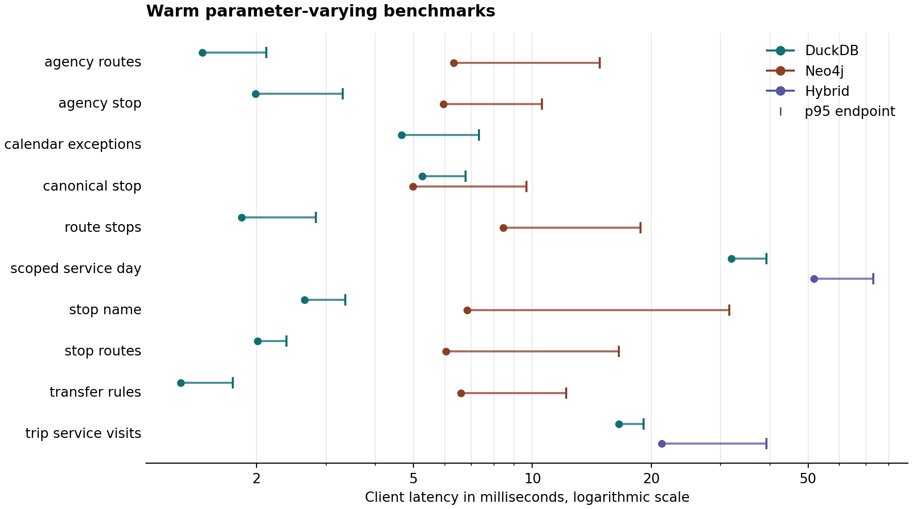

# TransitKG Phase 7 · Static graph audit and benchmark

**Validated on 25 November 2026.** The graph in `transitkg-static` has **115,683 nodes** and **242,491 relationships**. The Phase 5 expected fingerprint, Phase 6 imported fingerprint and both Phase 7 readbacks match. All directed endpoints, identity keys, typed properties and 13 logical partition digests also matched. There were **724/724 successful timed executions** and zero timeouts. [Static invariance](static_invariance_report.json) · [Raw timings](query_benchmark_samples.parquet)

## Evidence and safety

Reviewed the Phase 2 dataset and referential reports, Phase 3 canonical contract and normalized manifest, Phase 4 architecture, schema, SQL/Cypher contracts and bounded benchmarks, Phase 5 graph-ready publication and fingerprints, and Phase 6 construction, replay, visualization and testing evidence. The Phase 6 manifest pinned the actual database ID and graph-ready manifest hash. The preflight reopened the graph-ready Parquet, audited complete record sets against normalized SQL and independently verified the actual Neo4j graph. Both audits verified exact schema definitions, online indexes, all approved properties and no undeclared content. Follow-up checks covered 27 raw files, 32 normalized Parquet files, 13 graph-ready files, the normalized manifest and the Phase 6 manifest. [Phase 6 contract](../phase6/phase7_validation_contract.md) · [Before audit](audit_before.json) · [After audit](audit_after.json)

Before and after, SHA-256 was **675d71bd4e8bd82ffc1ec0d8951ca527928ca4376c681e40193d14f451892e66**. Canonical IDs retained exact source spellings, UTF-8 and nullable property semantics. Complete graph-to-Parquet agreement and normalized SQL checks covered agency-route, route-trip, trip-service, route-stop, agency-stop, hierarchy and nullable transfer identities. The two conflicting direction labels and 68 unresolved fare transfer variants stayed outside authoritative facts. All 118,128 mappings are accounted for by graph entities and 2,446 external shapes. The normalized build retains 3,185,115 visits, 1,340,496 shape points, 100,912 arrivals and 100,948 departures above 24 hours, and five calendar rows ending in 2099. The snapshot gate and synthetic mismatched-build cases were exercised.

The authenticated account has `admin` and `PUBLIC` roles and the catalog lists an explicit write grant. The audit used the exact target, Neo4j read routing, read transactions and fixed read queries. Timed queries checked update counters. Database access control still permits admin writes. A dedicated read-only principal remains a Phase 8 protection opportunity. [Environment and grants](benchmark_environment.json)

## Graph structure

| Label | Nodes | Isolated |
|---|---:|---:|
| Agency | 41 | 0 |
| FeedSnapshot | 1 | 1 |
| Route | 665 | 0 |
| Service | 485 | 2 |
| Stop | 21,664 | 119 |
| Trip | 92,827 | 0 |

| Relationship type | Edges |
|---|---:|
| AGENCY_SERVES_STOP | 19,904 |
| HAS_TRIP | 92,827 |
| OPERATES | 665 |
| PART_OF | 2,222 |
| ROUTE_SERVES_STOP | 33,985 |
| RUNS_ON | 92,827 |
| TRANSFER_RULE | 61 |

A streamed union-find calculation treated all stored edges as undirected for weak connectivity. It found **160 components**, **122 singletons**, and a largest component of **109,317 nodes (94.50%)**. This measures graph connectivity across all modeled relationship types. The stop hierarchy reaches depth **1**, with 2,222 child→parent edges. The 122 isolated nodes are the metadata singleton, two unused service definitions and 119 locations. An independent source query found 36 type-0 stops and 83 type-1 stations without an incident served-stop, hierarchy or transfer relation. These are accepted source entities. The two unused services are `SF:every-day` and `tf:20260101-20261231`.

The stored statistics include full in/out histograms by label, endpoint label/type counts, per-route and per-agency association distributions, component composition, hierarchy depth, representative highest-degree nodes and transfer restrictions. **44 of 61** transfer rules have two route qualifiers. Structural connectedness does not establish physical or time-feasible travel. [Structural analysis](structural_analysis.json)

## Competency questions and AC Transit regression

All 14 approved Cypher contracts matched the complete normalized SQL results. The table shows equal reference and observed result counts. Additional exact canonical lookup of agencies, routes, trips and stops, short-name route lookup, a dated trip descriptor and benchmark cases with negative and positive selectors passed. Frequency service is inapplicable to this feed. Dynamic alert retrieval remains a future competency. [Exact query contracts](../../schema/competency.cypher) · [Phase 4 design](../phase4/competency_questions.md) · [Case-level results and reference digests](competency_cases.json)

| Query | Purpose | Parameters | Expected = actual rows |
|---|---|---|---:|
| G1 | Agency-stop canonical ground | AC / 55660 | 1 |
| G2 | Stop-name ambiguity | San Pablo Av & W Grand Av | 2 |
| G3 | Agencies at a stop | 55660 | 1 |
| G4 | Route canonical ground | AC / AC:72 | 1 |
| G5 | Trip canonical lookup | AC:10056070 | 1 |
| G6 | Routes at a scoped stop | AC / 55660 | 4 |
| G7 | Stops on a route | AC:72 | 152 |
| G8 | Trip templates on a route | AC:72 | 247 |
| G9 | Service of a trip | AC:10056070 | 1 |
| G10 | Parent station children | -325 | 2 |
| G11 | Scoped transfer | 241 → 241 | 1 |
| G12 | Multi-agency stops | All stops | 189 |
| G13 | Route, type and direction | AC / AC:72 / type 3 / direction 0 | 126 |
| G14 | Snapshot gate | Pinned manifests | 1 |

The agency-scoped AC/55660 query produced **4 paths, 6 distinct nodes and 8 distinct relationships**. The four canonical routes are `AC%3A72`, `AC%3A72L`, `AC%3A72M` and `AC%3A802` under the regional route namespace. The graph and timetable resolve **EXACT_MATCH** to `511-sf-bay-regional:stop:55660` with **345 templates**, including **112** on **2026-11-25**. The same-name stop 52227 has its own ID and **339** templates. Wrong-agency and contradictory-direction cases return zero. These are scheduled candidates within the selector scope. The extended-hour reference trip includes an arrival and departure at 86,568 service-day seconds. The exact ordered visit and calendar exception tests preserve GTFS service-day semantics. [Regional audit](audit_before.json)

## Benchmark protocol and observed latency

The designed static workload uses ten query families and nineteen engine/query variants. Cases include actual low- and high-degree stops, small and large routes, several agencies, shared stops, ambiguous names, absent identifiers, dates with exceptions and restricted transfers. Selection is deterministic. Seed **731511** shuffles variant order within round. Each variant uses one initial execution, 5 warm-ups and 30 parameter-varying measured executions. Canonical lookup and date-scoped visits additionally use ten same-parameter executions per applicable variant. Of the 724 retained rows, 610 are warm measurements.

One worker uses reused connections and fully consumes results. The per-engine timeout is 15 seconds. SQL watchdog and Bolt timeout failures are recorded without retries. Result equality is checked outside timing. Client timings use elapsed wall time. Neo4j submission, full consumption and Bolt reported available/consumed durations are stored separately. DuckDB timing includes execution and local fetch. Hybrid timing includes graph lookup, parameter conversion and local timetable access. Initial samples are after audit and workload selection on a running server. Cache state was neither cleared nor controlled. p50 and p95 use linear interpolation at rank `(n−1)p`. Machine-readable summaries include min, max, mean, sample standard deviation, IQR, result cardinality and failure rates. [Protocol](benchmark_protocol.json) · [Latency statistics](query_benchmark_results.json) · [Pair and per-case comparisons](benchmark_comparisons.json)

| Workload | Engine | Initial ms | Warm p50 ms | Warm p95 ms | Result rows |
|---|---|---:|---:|---:|---:|
| agency_routes | duckdb | 1.307 | 1.458 | 2.118 | 1–123 |
| agency_routes | neo4j | 260.491 | 6.326 | 14.801 | 1–123 |
| agency_stop | duckdb | 6.362 | 1.991 | 3.311 | 0–1 |
| agency_stop | neo4j | 90.671 | 5.958 | 10.584 | 0–1 |
| calendar_exceptions | duckdb | 10.343 | 4.669 | 7.321 | 1–1 |
| canonical_stop | duckdb | 5.152 | 5.252 | 6.773 | 0–1 |
| canonical_stop | neo4j | 70.932 | 4.988 | 9.649 | 0–1 |
| route_stops | duckdb | 3.523 | 1.832 | 2.826 | 2–228 |
| route_stops | neo4j | 155.369 | 8.448 | 18.820 | 2–228 |
| scoped_service_day | duckdb | 39.934 | 31.892 | 39.240 | 0–112 |
| scoped_service_day | hybrid | 340.139 | 51.723 | 73.111 | 0–112 |
| stop_name | duckdb | 3.680 | 2.647 | 3.362 | 0–18 |
| stop_name | neo4j | 73.400 | 6.833 | 31.529 | 0–18 |
| stop_routes | duckdb | 3.185 | 2.013 | 2.380 | 1–18 |
| stop_routes | neo4j | 215.054 | 6.035 | 16.558 | 1–18 |
| transfer_rules | duckdb | 3.694 | 1.287 | 1.741 | 1–2 |
| transfer_rules | neo4j | 123.007 | 6.590 | 12.179 | 1–2 |
| trip_service_visits | duckdb | 25.700 | 16.578 | 19.158 | 37–77 |
| trip_service_visits | hybrid | 127.406 | 21.242 | 39.245 | 37–77 |

| Same parameter | Engine | p50 ms | p95 ms |
|---|---|---:|---:|
| canonical_stop | duckdb | 5.469 | 6.804 |
| canonical_stop | neo4j | 4.153 | 8.463 |
| scoped_service_day | duckdb | 33.922 | 41.499 |
| scoped_service_day | hybrid | 56.349 | 61.584 |

### Hybrid stage costs

| Workload | Neo4j p50 ms | DuckDB p50 ms | Bridge p50 ms | End-to-end p50 ms |
|---|---:|---:|---:|---:|
| scoped_service_day | 5.514 | 45.994 | 0.003 | 51.723 |
| trip_service_visits | 5.486 | 14.902 | 0.002 | 21.242 |

Component medians are calculated separately. The end-to-end figure includes orchestration. Direct DuckDB had the lower median on **8 of 9 paired workloads**. For exact stop lookup the lower median was observed in Neo4j and the lower p95 in DuckDB. Both dated hybrid workloads add graph and result conversion work around SQL. Neo4j supplies typed connectivity and inspectable scope. DuckDB evaluates the date, timetable and ordered visit predicates. The tests compare equal row multisets and pinned snapshots for each pair. They reflect local Bolt-plus-decoding versus in-process DuckDB from Parquet. [Paired measurements](benchmark_comparisons.json)

### Plans and likely bottlenecks

| Workload | Neo4j profiled operators | Database hits | Largest operator rows |
|---|---|---:|---:|
| canonical_stop | ProduceResults → Projection → NodeUniqueIndexSeek | 3 | 1 |
| route_stops | ProduceResults → Projection → Filter → Expand(All) → Sort → Projection → NodeIndexSeek | 1,143 | 228 |
| agency_stop | ProduceResults → Projection → Filter → Expand(All) → NodeIndexSeek | 8 | 1 |
| stop_name | ProduceResults → Projection → Sort → Projection → NodeIndexSeek | 55 | 18 |
| transfer_rules | ProduceResults → Projection → CacheProperties → Filter → Expand(All) → NodeIndexSeek | 14 | 2 |
| scoped_service_day | ProduceResults → Projection → Sort → Projection → Expand(Into) → Filter → Expand(All) → Filter → Expand(All) → NodeIndexSeek | 43 | 4 |
| trip_service_visits | ProduceResults → Projection → Filter → Expand(All) → NodeUniqueIndexSeek | 7 | 1 |

Canonical keys and indexed exact attributes provided selective entry points in sampled Neo4j plans. Expansion and result sorting become more visible for large routes, and name ambiguity increases both result work and tail latency. DuckDB plans for date-scoped service and ordered trip visits read Parquet and join timetable/calendar data. Their time also depends on filtering, join and materialization costs. Profile values come from separately instrumented executions. The raw plans include estimated and actual rows, memory and page-cache counters where exposed. No timed sample uses profiling. [Raw Neo4j and DuckDB plans](query_plan_analysis.json)

## Resources and storage

The run used Windows-11-10.0.26300-SP0, 13th Gen Intel(R) Core(TM) i5-13450HX, 16 logical CPUs and 16,091.87 MiB RAM. The observed project storage medium was **NVMe**. Python 3.14.0, Neo4j Enterprise 2026.10.2, Bolt driver 6.4.1 and DuckDB 1.5.0 were used. Neo4j reported an initial heap of 512.00MiB, a maximum heap of 1.00GiB and a page cache of 512.00MiB. DuckDB used two threads and a 768 MB memory limit.

The benchmark stage and associated case validation took **10.428 s** wall and **8.969 s** client CPU. Full client audit, plan and benchmark work took **83.842 s** wall and **73.172 s** CPU. Peak client working set was **814.18 MiB**. Server working set at benchmark end was **858.75 MiB** and lifetime peak at that sample was **1,047.72 MiB**. The starting server process sample was unavailable, so benchmark-interval server CPU and memory change are unreported. DuckDB spill at the end of the audit was 0 bytes. Peak spill was not sampled. [Benchmark environment](benchmark_environment.json)

| Layer | Logical bytes | MiB |
|---|---:|---:|
| Raw GTFS | 296,177,172 | 282.46 |
| Normalized Parquet | 61,576,978 | 58.72 |
| Graph-ready Parquet | 1,406,381 | 1.34 |
| Neo4j graph store, including indexes | 56,059,745 | 53.46 |
| Indexes within store | 21,282,816 | 20.30 |
| Dedicated transaction and checkpoint logs | 26,307,682 | 25.09 |
| Dedicated database including logs | 82,367,427 | 78.55 |
| Hybrid operational footprint including logs | 143,944,405 | 137.28 |

The online sample was taken after a naturally completed checkpoint at `2026-11-24 22:10:06.963+0000`. It measures logical file lengths for the dedicated store and log directories. It excludes other databases, Neo4j installation files and intermediate artifacts from the hybrid total. Graph-ready and normalized figures are Parquet payloads and exclude JSON manifests. Physical allocation and sparse/compressed-file effects are unmeasured. Neo4j blocks can share categories, so node, relationship and property storage cannot be separately attributed in full. The file inventory preserves exact per-file sizes. The Phase 6 immediate sample of 1,443,407 bytes preceded this later checkpoint-backed observation and undercounted the populated store. [Storage file inventory](storage_measurement.json)

## Architecture and construction evidence

| Phase 4 comparison | Nodes | Relationships | Compact node reduction | Compact edge reduction |
|---|---:|---:|---:|---:|
| B_compact | 115,683 | 242,491 | 0.00% | 0.00% |
| A_visit_edges | 115,683 | 3,427,606 | 0.00% | 92.93% |
| A_visit_nodes | 3,300,798 | 6,612,721 | 96.50% | 96.33% |
| C_patterns | 117,608 | 388,486 | 1.64% | 37.58% |

Only the compact regional graph was measured. The other counts are dataset-derived model alternatives. Record counts alone cannot predict flush size, construction time or lookup latency.

Phase 6 is one production construction run. It took **240.146 s** end to end. Per-stage measurements support **2,653.46 nodes/s** and **3,310.10 relationships/s**, using their respective load timings. There were 187 committed batches with no retries. Batch latency p50/p95 was **547.93/998.97 ms**. Schema application took 0.816 s and index readiness verification 0.127 s. Dual readback took 53.659 and 57.083 s. This audit reused that evidence without rebuilding. Readback is a substantial part of verified construction cost. [Cardinality and construction evidence](architecture_and_construction.json)

## Tests, limitations and readiness

| Offline phase | Passed | Failed or errored | Skipped |
|---|---:|---:|---:|
| 2 | 7 | 0 | 0 |
| 3 | 10 | 0 | 0 |
| 4 | 13 | 0 | 0 |
| 5 | 8 | 0 | 0 |
| 6 | 12 | 0 | 0 |
| 7 | 6 | 0 | 0 |

The full live audit and benchmark acceptance passed. Optional concurrency, architecture subset writes, controlled cold-cache testing and deliberate live interruption were deferred. The study focuses on single-client regional queries. Phase 6 verified live completed-build replay and verified interruption handling in synthetic fixtures. Live interruption remains unverified. No manual action is required for this read-only evaluation.

The data supports exact mapping guarantees within one pinned regional snapshot and reliable joins between typed graph scope and timetable predicates. The designed cases, warm/server cache state, result cardinality, one local host, short measurement series and one prior construction run limit generalization. These results do not establish UI latency, fleet-scale concurrency, real alert traffic behavior, external operator crosswalks, model extraction quality or future dynamic update costs. The benchmark uses equal result multisets. Query implementations and storage access paths differ intentionally across engines. [Test evidence](automated_test_report.json) · [Phase 8 readiness contract](phase8_readiness_contract.md)

## Reproduction

The implementation chose the deterministic seed, case-selection rules, one worker, 15-second per-engine timeout and 30 warm varying rounds. Set the project Python environment and securely provide Neo4j connection settings to the process. From the workspace root in PowerShell:

~~~powershell
$env:PYTHONPATH = '.phase2-deps'
$env:TRANSITKG_PHASE3_BUILD = (Resolve-Path 'data/normalized/build-5608c0d7d93b9c6200431b5c').Path
python scripts/benchmark_static_graph.py --output reports/phase7-rerun
python scripts/test_static_graph_benchmark.py --report reports/phase7-rerun
python scripts/report_static_graph_benchmark.py --input reports/phase7-rerun
~~~

Benchmark reruns require a fresh output directory, so existing evidence cannot be overwritten. Use `--input reports/phase7` to regenerate this report without querying Neo4j. The report command checks raw Parquet against the stored statistics before regenerating the figure, tables and handoff. Matplotlib is required for figure generation. Add `--server-pid` with the PID verified to own the local Bolt port to sample server process statistics.

Official references for plan interpretation and timing fields were checked on 25 November 2026. [Neo4j execution plans](https://neo4j.com/docs/cypher-manual/current/planning-and-tuning/execution-plans/) · [Neo4j driver results](https://neo4j.com/docs/python-manual/current/result-summary/) · [DuckDB EXPLAIN ANALYZE](https://duckdb.org/docs/stable/guides/meta/explain_analyze.html)
